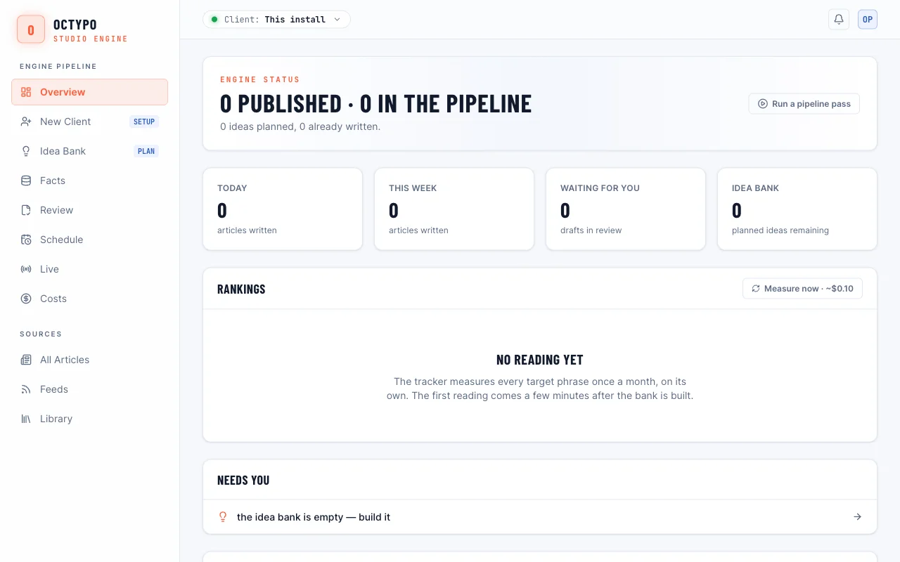
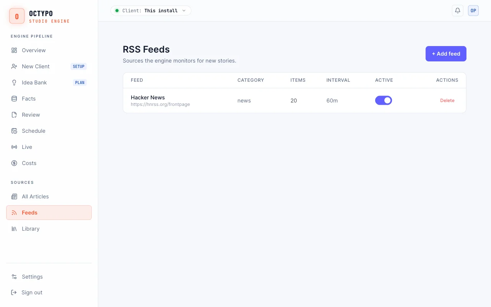
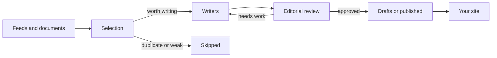

# Octypo

**A self-hosted engine that turns feeds and your own documents into fact-checked
articles, in any language.**

```bash
npm install -g octypo
```

[](https://github.com/KBRglobal/octypo-engine-oss/actions/workflows/ci.yml)
[](LICENSE)
[](https://nodejs.org)



Most AI writing tools give you text and leave the checking to you. Octypo runs the
whole editorial line on your own server: it picks what is worth writing about,
writes the article, checks it, and holds anything that fails for a person to review.

## Features

- **Any language.** Set a language and country per site or topic, from the 185
  ISO 639-1 codes. Articles are written natively, not translated.
- **Your choice of model.** Use Anthropic, OpenAI, Gemini, Groq, OpenRouter, Mistral,
  DeepSeek, Together or Perplexity, with automatic fallback between them.
- **A specialist model per language.** Connect any OpenAI-compatible endpoint, hosted
  or local, for the languages it writes best.
- **Quality gates.** Articles are scored and reviewed, numbers are checked against
  their sources, and duplicates are caught before writing starts.
- **You stay in control.** Articles wait as drafts by default, and a daily spend limit
  stops generation before costs run away.
- **Built to publish.** Includes an admin panel, a REST API, an Astro blog, structured
  data and IndexNow pings.

## Project status

This is an early public release, and there will be rough edges. The automated tests
do not call real models, so read your first articles closely before you turn on
automatic publishing. The [known limitations](#known-limitations) are listed below.

## Quick start

You need [Node 20 or newer](https://nodejs.org), [Docker](https://www.docker.com) for
the bundled Postgres, and a key from one model provider.

```bash
npm install -g octypo
mkdir my-site && cd my-site
octypo init        # creates .env and docker-compose.yml
```

Add your model key to `.env`, for example `ANTHROPIC_API_KEY=...`. Then start it:

```bash
octypo db          # starts Postgres
octypo start       # applies migrations and runs the engine
```

Open <http://localhost:3000/admin> and sign in with the `ADMIN_PASSWORD` from `.env`.
If something does not work, run `octypo doctor`.

## Your first article

Open **Feeds** in the admin panel and add an RSS feed. The engine checks feeds on a
schedule. To start right away, select **Run a pipeline pass** on the Overview page.



Finished articles wait in **Review**. Set `AUTO_PUBLISH=true` to publish approved
articles without review.

Model calls cost money. The engine stops for the day at `OCTYPO_DAILY_COST_CAP_USD`,
which is 5 USD by default. See **Costs** in the admin panel for what you have spent.

## How it works



1. **Selection** scores each item for search value and removes duplicates.
2. **Writers** draft the article using one of eight editorial personas.
3. **Editorial review** approves it, rejects it, or sends it back for a revision.
4. **Publishing** adds structured data, then serves it over the API or to your site.

## Languages

Set the language and country in the admin panel. The default is English (`en`, `US`).

To connect a model that specializes in one language, add it to `.env`:

```sh
LANGUAGE_ENGINES_JSON='{"ja":{"baseURL":"https://host.example/v1","model":"model-name","apiKeyEnv":"JA_MODEL_KEY"}}'
JA_MODEL_KEY=your-key
```

| Field | Required | Meaning |
| --- | --- | --- |
| `baseURL` | Yes | An OpenAI-compatible endpoint |
| `model` | Yes | The model name |
| `apiKeyEnv` | No | The variable that holds the key. Leave it out for a local server |
| `maxTokens` | No | The output limit, 8192 by default |
| `jsonMode` | No | Set to `true` if the endpoint supports `response_format` |

A general provider key is still required. It runs the helper steps, and it takes over
if the language model fails.

## Connect your site

- **Use the included blog.** [`blog/`](blog/README.md) is an Astro front end that
  renders articles from the engine.
- **Use the API.** [API.md](API.md) documents the endpoints for your own site.
- **Sync to an Astro site.** [`astro-kit/`](astro-kit/README.md) pulls articles into
  an existing project.

## Configuration

Settings live in `.env`. [`.env.example`](.env.example) lists all of them.

| Variable | Default | Purpose |
| --- | --- | --- |
| `DATABASE_URL` | — | Postgres connection string (required) |
| `ANTHROPIC_API_KEY`, `OPENAI_API_KEY`, `GEMINI_API_KEY`, `GROQ_API_KEY` | — | Model providers (set at least one) |
| `ADMIN_PASSWORD` | Set by `octypo init` | Admin panel password |
| `CONTENT_DOMAIN` | `general news and analysis` | The subject your site covers |
| `AUTO_PUBLISH` | `false` in `.env.example` | Publish approved articles without review |
| `OCTYPO_DAILY_COST_CAP_USD` | `5` | Daily limit on model spend |
| `LANGUAGE_ENGINES_JSON` | — | A specialist model per language |
| `RSS_INTERVAL_MINUTES` | `30` | How often feeds are checked |
| `RSS_GLOBAL_DAILY_LIMIT` | `20` | Maximum articles per day |
| `SITE_URL` | — | Enables IndexNow pings and canonical URLs |

Topics live in `src/config/topics.ts` or in `TOPICS_JSON`. Hero images need an OpenAI
key and a Cloudflare R2 bucket. Without them, articles publish without images.

## Known limitations

- The admin panel and reports are in English only.
- Most word-list checks exist only for English. Other languages skip them, so a problem
  those checks would catch can get through. [Help add a language](CONTRIBUTING.md#adding-language-support).
- Right-to-left styling in the blog is not complete.
- Spend on language models from `LANGUAGE_ENGINES_JSON` is not counted toward the daily
  limit, because their prices are unknown.

## Contributing

Contributions are welcome, especially from native speakers. See
[CONTRIBUTING.md](CONTRIBUTING.md) and the [Code of Conduct](CODE_OF_CONDUCT.md). To
report a vulnerability, see [SECURITY.md](SECURITY.md).

## License

[MIT](LICENSE)
